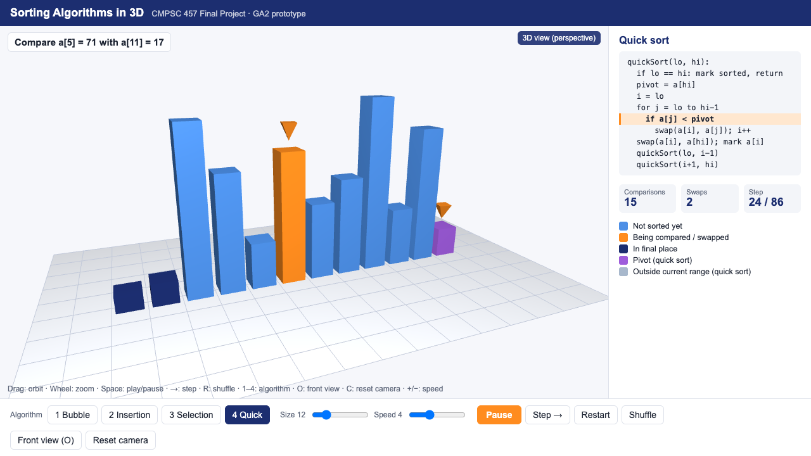

# Sorting Algorithms in 3D

An interactive WebGL educational tool that shows how sorting algorithms work, one compare and swap at a time, on a row of lit 3D bars.

CMPSC 457 Final Project · Team: Om Yagnesh Patel, Aaditya Raval, Jyoti Prajapati, Divya Patel



> **Status (GA2 checkpoint, Nov 19, 2026):** working prototype. All six required features run. Bézier swap paths have a first version. Blending and picking are still to do (see [Roadmap](#roadmap)).

## How to run

No build step and no install. You only need a browser with WebGL 2 (current Chrome, Edge, Firefox or Safari).

**Option 1: open the file.** Double-click `index.html`. It works straight from disk, because the shaders are inside the HTML file.

**Option 2: local server** (use this if your browser blocks local files):

```bash
cd sorting-algorithms-3d
python3 -m http.server 8000
```

Then go to <http://localhost:8000>.

## Controls

| Action | Mouse / UI | Keyboard |
|---|---|---|
| Choose algorithm | Bubble / Insertion / Selection / Quick buttons | `1` `2` `3` `4` |
| Play or pause (pause freezes mid-step) | Play / Pause button (shows **Replay** when a sort has finished) | `Space` |
| One step at a time (finishes a paused step first) | Step → button | `→` |
| Start the same array again | Restart button | |
| New random array | Shuffle button | `R` |
| Array size (5 to 40) | Size slider | |
| Animation speed (1 to 10) | Speed slider | `+` / `-` |
| Orbit the camera | Drag on the 3D view with the left button | |
| Zoom (3D and front view) | Mouse wheel | |
| Front orthographic view on/off (no orbiting in this view) | Front view button | `O` |
| Reset the camera | Reset camera button | `C` |

**Colours:** blue = not sorted yet · orange = being compared or swapped (with spinning marker pyramids above) · navy = in its final place · purple = quick-sort pivot · grey-blue = outside quick sort's current range.

The side panel shows the pseudocode with the running line highlighted, plus live counts of comparisons, swaps and steps.

Shortcuts are ignored when Cmd, Ctrl or Alt is held, so browser shortcuts such as reload and zoom still work.

## How the course requirements are met

| # | Requirement | Where in the code |
|---|---|---|
| 1 | 3D geometry from our own vertex data | `js/geometry.js`: box (24 vertices, 36 indices, per-face normals), marker pyramid, floor quad, grid lines |
| 2 | Model-view transformations | `js/main.js` `drawBars()`: `view × translate(slot) × scale(width, value, depth)`; `drawMarkers()`: `view × translate × rotate × scale` |
| 3 | Camera with `lookAt` + `perspective` / `ortho` | `js/camera.js`: orbit camera with `lookAt()` and `perspective(45, aspect, 0.1, 100)`; `O` switches to `ortho()` |
| 4 | User interaction | `js/controls.js` `setupUI()`: buttons, sliders, keyboard, mouse drag and wheel |
| 5 | Animation with `requestAnimationFrame` | `js/main.js` `render()` → `frame(dt)`; `js/animator.js` interpolates each step |
| 6 | Lighting and shading | `index.html` fragment shader: per-fragment Phong (ambient + diffuse + specular) with one point light |

**Advanced features**

| Feature | Status |
|---|---|
| Curves (cubic Bézier swap paths) | **First version works.** Swapped bars travel on Bézier arcs, one in front and one behind, and the paths are drawn as dashed lines (`js/animator.js` `bezier3()`, `swapPaths()`). |
| Blending (see-through unsorted bars) | To do (11/19 – 11/25). Right now, quick sort's out-of-range bars use a dimmed colour. |
| Picking (click a bar to see its value and index) | To do (11/26 – 12/2) |

## Project structure

```
sorting-algorithms-3d/
├── index.html          page layout + GLSL vertex and fragment shaders
├── css/style.css       layout of the canvas, side panel and control bar
├── Common/
│   ├── MV.js           vector/matrix library (same API as the textbook's MV.js)
│   └── initShaders.js  compiles and links the shaders from the <script> tags
├── js/
│   ├── geometry.js     our own vertex data: box, pyramid, floor, grid
│   ├── sorts.js        step recorder for the 4 sorts + their pseudocode
│   ├── animator.js     plays the recorded steps; Bézier swap paths
│   ├── camera.js       orbit camera (lookAt, perspective, ortho)
│   ├── panel.js        side panel: pseudocode highlight, counters, labels
│   ├── controls.js     buttons, sliders, keyboard and mouse input
│   └── main.js         WebGL setup, render loop and drawing
└── docs/screenshot.png
```

### How it works

1. **Step recorder** (`sorts.js`): when you pick an algorithm or shuffle, the sort runs instantly on a copy of the array. It records every move as a list of steps: `compare i j`, `swap i j`, `sorted i`, `pivot i`, `range lo hi`.
2. **Animator** (`animator.js`): plays that list one step at a time. Each step lasts a set time, which the speed slider controls. A swap moves the two bars along cubic Bézier curves with an ease-in/ease-out. Because the animation only replays recorded steps, it always matches the real algorithm.
3. **Renderer** (`main.js`): every frame it builds the view and projection matrices from the camera and moves the light into eye space. Then it draws the floor, the bars (one shared box buffer, a different model-view matrix for each bar), the marker pyramids and the dashed swap paths.

### Note on MV.js

`Common/MV.js` uses the same function names and conventions as the textbook's MV.js: row-major matrices, and `flatten()` transposes them for WebGL. You can drop in the course's copy of `MV.js` in its place. `main.js` works with both the 7th-edition (`scalem`) and 8th-edition (`scale`) names for the scaling matrix.

## Roadmap

| Week | Goal |
|---|---|
| 11/19 – 11/25 | Blending: unsorted bars see-through (solid bars first, then transparent bars back to front with `gl.depthMask(false)`); input presets (random / reversed / nearly sorted); tune Bézier swaps; swap in the course copy of MV.js |
| 11/26 – 12/2 (Thanksgiving) | Picking: off-screen ID-colour pass + `gl.readPixels()`, info box with value, index and compare count; arrow-key selection as the backup |
| 12/3 – 12/10 | Testing in Chrome, Firefox and Safari; bug fixes and polish; final README and demo video; merge sort / race mode only if ahead |

## Testing

Tested in Chrome on macOS:

- All four algorithms were run to the end at sizes 5, 12 and 40. Each final array matched a reference sort.
- Play / Pause / Step / Replay: pausing freezes mid-step, Step finishes exactly one step, and no queued steps run after a pause.
- Keyboard (including held keys and browser shortcuts), left-drag orbit, wheel zoom in both views, and canvas resizing.
- The browser console showed no errors or warnings.
